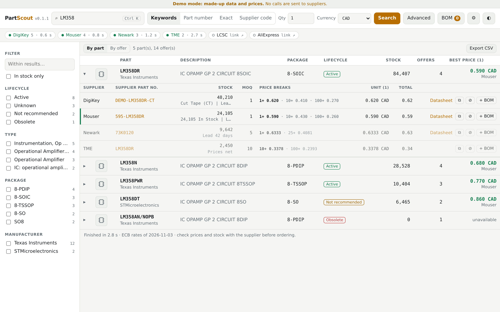
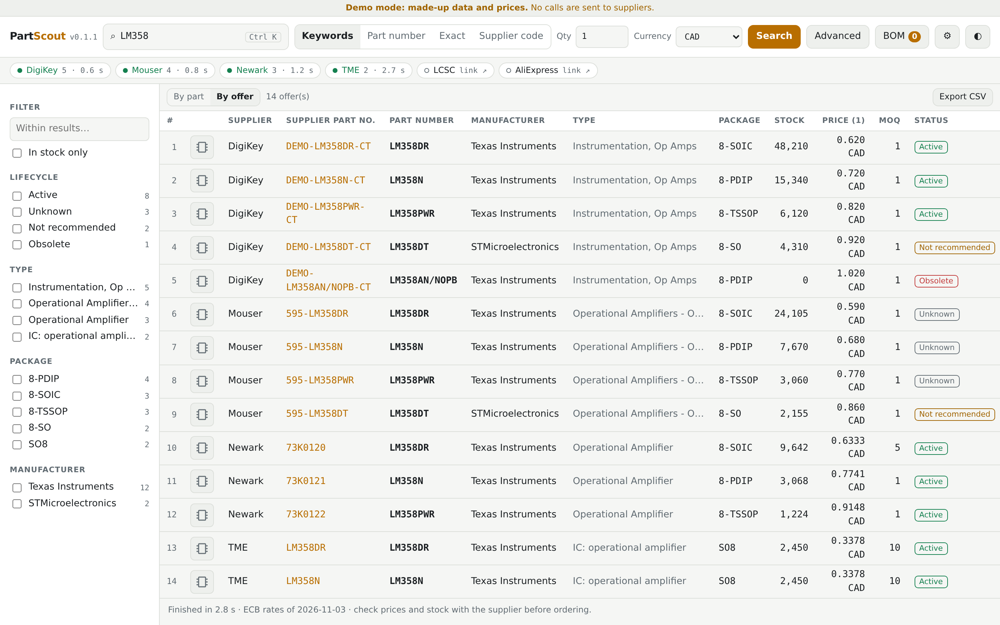

<p align="center"></p>

# PartScout

*[English](README.md) · Français*

Cherche une pièce électronique chez plusieurs fournisseurs à la fois et compare stock, prix, paliers, MOQ, cycle de vie et datasheets. Application web sous Docker, usage personnel et non commercial.

Version web dérivée de [Win-PartsFinder](https://github.com/Ian-Johnston/WinPartsFinder), © 2026 Ian Johnston. Conditions : [LICENSE](LICENSE) et [NOTICE.md](NOTICE.md).

### Fait avec l'aide de l'IA
Par souci de transparence : la plus grande partie du code, des tests et de la documentation de PartScout a été écrite par un assistant IA (Claude, d'Anthropic), sous ma direction. J'ai décidé quoi construire, relu les résultats et testé l'application sur les vraies API des fournisseurs avant de la publier. Si les logiciels faits avec l'aide de l'IA ne sont pas pour vous, aucun problème : passez votre chemin. Les signalements de bugs restent les bienvenus.


*Regroupés par pièce, avec toutes les offres de la pièce et leurs paliers de prix. Données de démo.*


*Une ligne par offre, triable sur plusieurs colonnes, colonnes déplaçables. Données de démo.*

L'interface est en français et en anglais : bouton FR/EN en haut. La langue appartient au compte, sur tous ses appareils ; celle du navigateur ne décide que de la toute première visite. Les fournisseurs, la devise et le site DigiKey par défaut sont réglés pour le Canada ; ils se changent dans **Réglages**.

## Démarrer
Il faut Docker avec le plugin compose.
```bash
mkdir partscout && cd partscout
curl -fsSLO https://raw.githubusercontent.com/devzwf/partscout/main/docker-compose.yml
curl -fsSL -o .env https://raw.githubusercontent.com/devzwf/partscout/main/.env.example
chmod 600 .env    # puis remplacer les deux valeurs change-me : openssl rand -base64 32
docker compose up -d                       # http://hôte:5070
docker compose --profile demo up -d demo   # démo facultative aux données fictives : http://hôte:5071
```
Au premier accès, l'application demande le jeton d'installation (`PARTSCOUT_SETUP_TOKEN`) et fait choisir un mot de passe. Ajouter ensuite les clés d'API dans **Réglages**. Un fournisseur sans clé reste disponible en lien vers son site. Chaque utilisateur doit avoir ses propres clés : ne pas partager publiquement une instance sur les siennes.

**Clés d'API :** chaque fournisseur a son portail développeur (DigiKey, Mouser, element14, TME). Y créer un compte et respecter ses conditions d'utilisation.

**Plusieurs utilisateurs :** le premier compte est l'administrateur, qui crée les autres dans **Réglages** ; il n'y a pas d'inscription libre. Chacun a sa langue, ses clés d'API, ses réglages, ses BOM et son historique. Passer en HTTPS (reverse proxy) dès que plusieurs personnes se connectent : sinon, mots de passe et clés d'API circulent en clair sur le réseau.

**Pas pour Internet :** PartScout est prévu pour un réseau domestique ou un VPN privé. Voir [SECURITY.md](SECURITY.md).

Sauvegarder le dossier de données **et** le fichier `.env` : sans la clé maîtresse, il faut ressaisir les clés d'API. L'application écrit chaque heure une copie cohérente de sa base dans `backups/`, une par jour, gardée 14 jours.

**Restaurer :** arrêter le conteneur, retirer `partscout.db`, `partscout.db-wal` et `partscout.db-shm`, copier `backups/partscout-AAAA-MM-JJ.db` en `partscout.db` (propriétaire uid 1654), redémarrer. Ne pas utiliser les ports 5060 et 5061, bloqués par les navigateurs.

**HTTPS :** `docker compose --profile https up -d` ajoute Caddy devant l'application. Il sert les fichiers de certificat de `PARTSCOUT_CERT_DIR` et n'en demande pas lui-même : les renouveler avec son propre outil, puis redémarrer `partscout-caddy`. Voir `.env.example`. Ensuite, mettre `PARTSCOUT_PUBLISH=127.0.0.1:5070`.

## Mettre à jour
Mettre la nouvelle version dans `PARTSCOUT_VERSION` (`.env`), puis `docker compose up -d`. Pour revenir en arrière, remettre l'ancienne valeur. Les changements sont dans [CHANGELOG.md](CHANGELOG.md).

## Construire soi-même
```bash
git clone https://github.com/devzwf/partscout.git && cd partscout
tools/build-image.sh    # image locale partscout:<VERSION>, rien n'est poussé
```
Mettre ensuite `PARTSCOUT_IMAGE=partscout` et `PARTSCOUT_PULL_POLICY=never` dans `.env`. Pour une nouvelle version : changer `VERSION`, commiter, lancer `tools/build-image.sh`.

## Structure
| Dossier | Contenu |
|---|---|
| `backend/src/PartScout.Suppliers` | Code fournisseur repris de Linux-PartsFinder, adapté au minimum |
| `backend/src/PartScout.Api` | API ASP.NET Core : connexion, coffre à clés, recherche en flux, BOM, mode démo |
| `backend/tests` | Tests de l'API |
| `frontend` | Interface React ; logique métier dans `src/lib/parts.ts`, traductions dans `src/i18n.ts` |
| `tests/e2e` | Parcours complet dans Chromium |
| `upstream` | Copie intacte des fichiers repris, et commit d'origine |
| `tools` | `upstream-diff.sh` (changements de l'auteur), `ci-e2e.sh` (parcours navigateur sous Docker), `build-image.sh` |

## Tests
```bash
docker build --target backend-test .   # tests de l'API
(cd frontend && npm test)              # logique de l'interface
docker build -t partscout:test . && tools/ci-e2e.sh partscout:test   # parcours navigateur, sur une démo jetable
```
Le mode démo (`PARTSCOUT_DEMO=1`) simule les réponses d'API d'après le code des parseurs. **Il ne remplace pas un essai avec les vraies API.**

## Contribuer
Issues et pull requests bienvenues, en français ou en anglais ; merci d'utiliser les modèles. Les commentaires du code sont en français. Les contributions sont distribuées aux conditions du projet (voir [LICENSE](LICENSE)), restriction non commerciale comprise.
