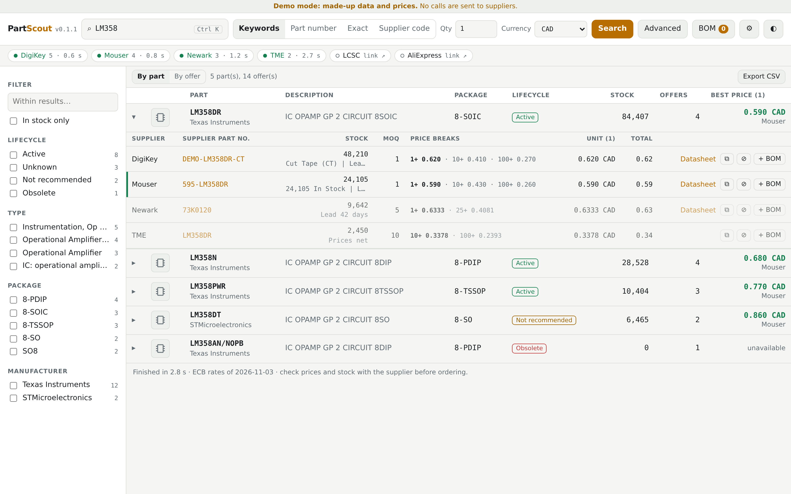
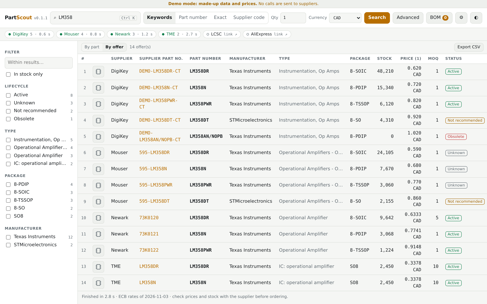

<p align="center"></p>

# PartScout

*English · [Français](README.fr.md)*

Search for an electronic part at several suppliers at once, and compare stock, prices, price breaks, MOQ, lifecycle and datasheets. A web app that runs in Docker, for personal, non-commercial use.

A web version derived from [Win-PartsFinder](https://github.com/Ian-Johnston/WinPartsFinder), © 2026 Ian Johnston. Terms: [LICENSE](LICENSE) and [NOTICE.md](NOTICE.md).

### Built with AI
In the interest of transparency: most of PartScout's code, tests and documentation were written by an AI assistant (Claude, by Anthropic), under my direction. I decided what to build, reviewed the results, and tested the app against the real supplier APIs before publishing it. If AI-assisted software is not for you, that is perfectly fine: feel free to pass on this one. Bug reports are welcome either way.


*Grouped by part, with every offer for the part and its price breaks. Demo data.*


*One line per offer, sortable on several columns, with movable columns. Demo data.*

The interface is in English and French: use the FR/EN button at the top. The language belongs to the account, on all its devices; the browser's language only decides the very first visit. The default suppliers, currency and DigiKey site are set for Canada; change them in **Settings** too.

## Getting started
You need Docker with the compose plugin.
```bash
mkdir partscout && cd partscout
curl -fsSLO https://raw.githubusercontent.com/devzwf/partscout/main/docker-compose.yml
curl -fsSL -o .env https://raw.githubusercontent.com/devzwf/partscout/main/.env.example
chmod 600 .env    # then replace both change-me values: openssl rand -base64 32
docker compose up -d                       # http://host:5070
docker compose --profile demo up -d demo   # optional demo with made-up data: http://host:5071
```
On first access, the app asks for the setup token (`PARTSCOUT_SETUP_TOKEN`) and has you choose a password. Then add your API keys in **Settings**. A supplier without a key stays available as a link to its website. Each user needs their own keys, so do not share an instance publicly on yours.

**Supplier API keys:** each supplier has its own developer portal (DigiKey, Mouser, element14, TME). Create an account there and follow their terms of use.

**Several users:** the first account is the administrator, who creates the others in **Settings**; there is no public sign-up. Each person has their own language, API keys, settings, BOMs and history. Use HTTPS (a reverse proxy) as soon as several people sign in: otherwise passwords and API keys travel in clear text over the network.

**Not for the Internet:** PartScout is meant for a home network or a private VPN. See [SECURITY.md](SECURITY.md).

Back up the data folder **and** the `.env` file: without the master key, you have to re-enter your API keys. Every hour the app writes a consistent copy of its database to `backups/`, one per day, kept for 14 days.

**Restoring:** stop the container, remove `partscout.db`, `partscout.db-wal` and `partscout.db-shm`, copy `backups/partscout-YYYY-MM-DD.db` to `partscout.db` (owner uid 1654), then start it again. Do not use ports 5060 and 5061: browsers block them.

**HTTPS:** `docker compose --profile https up -d` adds Caddy in front of the app. It serves the certificate files found in `PARTSCOUT_CERT_DIR` and does not request certificates itself, so renew them with your own tool and restart `partscout-caddy` afterwards. See `.env.example`. Then set `PARTSCOUT_PUBLISH=127.0.0.1:5070`.

## Upgrading
Put the new version in `PARTSCOUT_VERSION` (`.env`), then `docker compose up -d`. To go back, restore the old value. Changes are listed in [CHANGELOG.md](CHANGELOG.md).

## Building it yourself
```bash
git clone https://github.com/devzwf/partscout.git && cd partscout
tools/build-image.sh    # local image partscout:<VERSION>, nothing is pushed
```
Then set `PARTSCOUT_IMAGE=partscout` and `PARTSCOUT_PULL_POLICY=never` in `.env`. To release a new version: change `VERSION`, commit, run `tools/build-image.sh`.

## Layout
| Folder | Contents |
|---|---|
| `backend/src/PartScout.Suppliers` | Supplier code taken from Linux-PartsFinder, changed as little as possible |
| `backend/src/PartScout.Api` | ASP.NET Core API: sign-in, key vault, streaming search, BOM, demo mode |
| `backend/tests` | API tests |
| `frontend` | React interface; business logic in `src/lib/parts.ts`, translations in `src/i18n.ts` |
| `tests/e2e` | Full journey in Chromium |
| `upstream` | Untouched copy of the files taken, and the original commit |
| `tools` | `upstream-diff.sh` (the author's changes), `ci-e2e.sh` (browser journey in Docker), `build-image.sh` |

## Tests
```bash
docker build --target backend-test .   # API tests
(cd frontend && npm test)              # interface logic
docker build -t partscout:test . && tools/ci-e2e.sh partscout:test   # browser journey, on a throwaway demo
```
Demo mode (`PARTSCOUT_DEMO=1`) simulates API responses based on the parser code. **It does not replace a test against the real APIs.**

## Contributing
Issues and pull requests are welcome, in English or French; please use the templates. Code comments are in French. Contributions are distributed under the project's terms (see [LICENSE](LICENSE)), including the non-commercial restriction.
